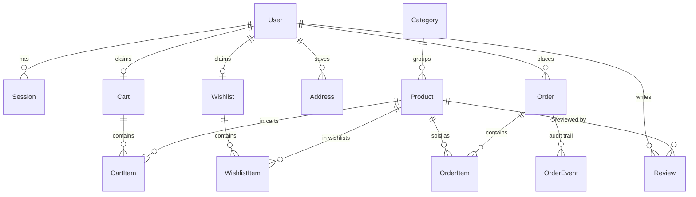

# HomeNest Kitchen — Master Project Architecture Document (PAD) v1.0

**Classification:** Internal Engineering Reference
**Status:** DEFINITIVE, PRODUCTION-LOCKED BLUEPRINT
**Companion Document:** `README.md` (quick start), `AGENTS.md` (agent traps), `CLAUDE.md` (conventions)
**Last Updated:** 2026-10-12
**Audience:** Senior Engineers, Tech Leads, DevOps, and Onboarding Engineers
**Rule:** Every architectural decision in this document traces to a specific rationale. Nothing is here "because it's popular."

#### Revision Block — v1.0 (Initial Blueprint)

- `[SR]` Initial PAD generated from the completed remediation: the repository was migrated from a client-only Vite SPA (localStorage "database") to a Next.js 16 + Prisma 6/SQLite full-stack application per the `nordeim/ecommerce-store` reference architecture.
- `[CA]` All ADRs below trace to verified failure modes observed during the migration (each is pinned by a test or a trap-log comment in code).

---

## Table of Contents

1. [System Overview & Decisions](#1-system-overview--decisions)
2. [High-Level System Topology](#2-high-level-system-topology)
3. [Application Architecture](#3-application-architecture)
4. [Data Architecture](#4-data-architecture)
5. [Design System Reference](#5-design-system-reference)
6. [Security Architecture](#6-security-architecture)
7. [Worker / Background Service Architecture](#7-worker--background-service-architecture)
8. [Testing Strategy](#8-testing-strategy)
9. [Build & Deployment](#9-build--deployment)
10. [Developer Handbook](#10-developer-handbook)
11. [Known Issues & Outstanding Tasks](#11-known-issues--outstanding-tasks)
12. [Key Files Reference](#12-key-files-reference)
13. [Glossary](#13-glossary)

---

## 1. System Overview & Decisions

### 1.1 Document Metadata & Purpose

HomeNest Kitchen is a premium kitchenware e-commerce storefront with a full admin back office, built as a visual-and-functional superset of the Base44 reference app (`https://nest-culinary-hub.base44.app/`). This PAD is the definitive statement of how the system is wired and why each decision was made. Use it: (a) when onboarding — sections 2–4 explain the whole system in one read; (b) when debugging — section 11 lists known failure modes and section 6 explains the CSP/hydration interaction that produces the most confusing symptoms; (c) when reviewing change proposals — every ADR names its rejected alternatives.

The starting point of this remediation was a client-only Vite SPA that kept the entire catalog, all users, orders, and auth in `localStorage` with unsalted client-side SHA-256 "password hashing." The remediation replaced that substrate with a real server, a real database, and real sessions while preserving (and exceeding) the SPA's feature surface and matching the reference site's visual design pixel-for-pixel where it matters.

### 1.2 Technology Stack Summary

| Layer | Technology | Version | Key Rationale |
|---|---|---|---|
| Web framework | Next.js (App Router, standalone output) | ^16.1 | RSC-first rendering, Server Actions, route handlers, the `proxy` convention for edge middleware; matches the `nordeim/ecommerce-store` reference architecture |
| UI runtime | React | ^19 | `useActionState`-native forms, Server Components |
| Language | TypeScript (strict) | ^5.9 | `strict` + `noUncheckedIndexedAccess`; `any` is lint-banned |
| Styling | Tailwind CSS (CSS-first) | ^4.1 | `@theme inline` tokens pinned to the reference's computed values; no config file |
| ORM / DB | Prisma + SQLite | ^6.11 | Zero-ops local story; relative `file:` URL contract (ADR-002) |
| UI primitives | Radix UI (dialog, select, sheet, label, tabs, radio) + CVA + lucide-react | latest | Accessible primitives; the shadcn pattern without the CLI |
| Charts | Recharts | ^3 | Admin revenue + analytics surfaces |
| Validation | Zod | ^3.25 | Single validation boundary (ADR-005) |
| Unit tests | Vitest | ^3.2 | Node-env pure-function suite (131 tests) |
| E2E tests | Playwright | ^1.64 | 32 tests incl. the Tailwind v4 mobile-nav regression guard |
| Fonts | next/font (Playfair Display + Inter) | — | Self-hosted at build, no runtime font requests |

### 1.3 Architecture Decision Records

**ADR-001: Next.js 16 App Router instead of a Vite SPA (or a separate API server).**

- **Context:** The prior codebase was a client-only SPA; the reference architecture (`ecommerce-store`) is a Next.js 16 + Prisma/SQLite monolith. A real storefront needs server-rendered catalog pages, server-authoritative checkout, and session auth — none of which a pure SPA can provide honestly.
- **Decision:** Next.js 16 App Router with `output: "standalone"`, RSC by default, Server Actions for form mutations, REST route handlers for client-island fetches.
- **Rationale:** One process, one deploy artifact, one language; the ecommerce-store reference proves the exact pattern in production for the same domain; Server Actions eliminate an entire REST layer for form flows while route handlers remain for `fetch`-based islands (cart badge updates, coupon application, search typeahead).
- **Consequences:** (+) No CORS, no duplicated validation, no client state library. (−) Requires the CSP/nonce discipline of ADR-006; server boundaries must be respected (`server-only` semantics for `src/lib/db.ts`).
- **Alternatives rejected:** Keeping the Vite SPA + bolting on an Express API (two runtimes, duplicated validation, no RSC); a tRPC layer (unnecessary for this surface size); a Postgres deployment (no managed instance in the target environment — see ADR-002).

**ADR-002: SQLite via a relative `file:../db/custom.db` resolved against `prisma/schema.prisma`.**

- **Context:** The brief mandates `.env` → `DATABASE_URL="file:../db/custom.db"` with `db/` at the repo root. Relative SQLite URLs are resolved *relative to the schema file* by the Prisma CLI — but the runtime (Next server, standalone build) resolves them against the process CWD, which differs between `next dev`, `next build`, and `.next/standalone/server.js` (which `chdir`s into its own folder).
- **Decision:** `src/lib/db-path.ts` implements the same rule as the CLI: a relative `file:` URL resolves against the first anchor directory that owns `prisma/schema.prisma` (standalone-detected first, then the module's repo root, then CWD). `src/lib/db.ts` applies it before instantiating `PrismaClient`. Absolute `file:` URLs and non-SQLite URLs pass through untouched.
- **Rationale:** One database file for CLI and runtime, regardless of CWD; the contract is pinned by `tests/unit/db-path.test.ts` and documented in `.env.example`.
- **Consequences:** (+) `db:push`, `db:seed`, dev, build, and production all agree on the file. (−) A production deploy should still pin an absolute `file:` URL. **Alternatives rejected:** Postgres (no instance available in the sandbox); absolute-only URLs (violates the documented fresh-checkout default).

**ADR-003: DB-backed sessions with an HMAC-signed cookie; scrypt password hashing.**

- **Context:** The SPA "auth" stored user rows and unsalted SHA-256 hashes in localStorage —任何人 can mint an admin. The reference implementation uses DB-backed sessions with a signed cookie.
- **Decision:** `Session` rows (SHA-256 token hashes) + cookie `homenest_session = <token>.<hmac(token)>`; `AUTH_SECRET` signs; 30-day TTL; scrypt (N=16384, r=8, p=1, 64-byte key) password format `scrypt$N$r$p$salt$hash` (`src/lib/password.ts`).
- **Rationale:** A crafted cookie fails the HMAC before touching the DB; stolen DB rows reveal only token *hashes*; scrypt is memory-hard with zero native deps; pure `node:crypto` so the seed script shares the module.
- **Consequences:** (+) Real auth, revocable sessions (row delete), no external auth service. (−) No OAuth (the reference's "Continue with Google" button is intentionally not replicated as a fake).
- **Alternatives rejected:** Auth.js (heavy for the surface); localStorage auth (the vulnerability being removed); JWT-only stateless sessions (no revocation).

**ADR-004: Guest carts/wishlists via token cookies, claimed and merged on login.**

- **Context:** The reference supports guest checkout; the SPA kept carts in localStorage (lost across devices).
- **Decision:** `Cart`/`Wishlist` rows keyed by a random `token` stored in an httpOnly cookie (`homenest_cart`, `homenest_wishlist`); on login, the guest cart's lines merge into the user's own cart (quantity-add), the guest row is deleted, and the cookie re-binds.
- **Rationale:** Same code path for guests and users; carts survive browsers and devices once claimed; checkout reads the cart server-side so money math (ADR-005) is authoritative.
- **Consequences:** (+) Guest checkout with zero signup friction. (−) Requires the merge logic (`src/lib/cart.ts`) and careful cookie lifetime (60/120 days).
- **Alternatives rejected:** LocalStorage carts (device-bound, spoofable); login-required carts (worse conversion than the reference).

**ADR-005: Integer-cent money; server-side total re-derivation via `computeOrderMoney`.**

- **Context:** Money bugs come from floats and from trusting the client.
- **Decision:** Every monetary column is INTEGER cents. `src/lib/order-money.ts#computeOrderMoney` is the single source of truth: `taxable = max(0, subtotal − discount)`, free shipping when `taxable ≥ freeShippingThresholdCents` (both methods — the threshold is a spend gate), `tax = round(taxable × rate / 100)`, `total = taxable + shipping + tax`. `/api/checkout` re-derives everything **inside the placement transaction** — the product rows are re-read there, the coupon is re-validated (`isCouponRedeemable`: active, unexpired, under its redemption cap) and its `timesUsed` incremented, and the stock reservation runs via conditional atomic decrements — one `db.$transaction` also writing order + items + `placed` event, clearing cart items, and optionally saving the address. The order is **idempotent**: a client-generated `idempotencyKey` (unique, nullable column) short-circuits replays to the already-placed order's receipt.
- **Rationale:** The checkout route can never be talked into a wrong total, a lost response can never double-order, and a concurrent price edit can never desync `total` from Σ(unitPrice×qty); `tests/unit/order-money.test.ts` pins the arithmetic including threshold edge cases.
- **Consequences:** (+) Order numbers are `ORD-YYYY-NNN` with P2002 retry inside the transaction (number collisions only — an idempotency-key collision resolves to the winner). (−) The client renders mirror totals only — UI must not pretend to be authoritative.
- **Alternatives rejected:** Stripe-backed pricing (no processor in scope; the demo payment is clearly labeled); trusting client totals (the vulnerability); deriving money from the pre-transaction cart summary (a TOCTOU window closed in session 3).

**ADR-006: Per-request CSP nonces via `src/proxy.ts`, and the prerender trap it creates.**

- **Context:** The Next 16 `proxy` convention (middleware successor) stamps `Content-Security-Policy` with a per-request nonce onto request + response; Next applies the request-header nonce to the scripts it renders. A **prerendered** page has no request at build time → its script tags carry no (or a stale) nonce → the browser silently blocks its scripts → the page paints but never hydrates, with zero console errors. This bit for real: `/login` and `/register` prerendered even under `export const dynamic = "force-dynamic"` on Next 16.4.
- **Decision:** `src/app/(auth)/layout.tsx` performs `await connection()` to force per-request rendering for the auth subtree (documented in place). Dev mode adds `'unsafe-eval'` to `script-src` (React dev builds require it); production never does. Directive set: `script-src 'self' 'nonce-…' 'strict-dynamic'`, `style-src 'self' 'unsafe-inline'`, `img-src 'self' data:`, `font-src 'self'`, `connect-src 'self'`, `frame-ancestors 'none'`, `object-src 'none'`, `base-uri 'self'`, `form-action 'self'`; plus `X-Frame-Options: DENY`, `nosniff`, HSTS, and a strict referrer policy from `next.config.ts` headers.
- **Rationale:** Nonce-based strict-dynamic CSP is the strongest practical XSS posture for an RSC app; the pure builder (`src/lib/csp.ts`) is unit-tested (`tests/unit/csp.test.ts`).
- **Consequences:** (+) Superset hardening over the reference (which ships no CSP). (−) Every future static/prerendered route that must hydrate needs the same treatment; the `/_not-found` prerender intentionally stays script-less-safe (links + CSS only).
- **Alternatives rejected:** No CSP (parity with the reference but weaker); hash-based CSP (impossible with Turbopack chunk hashes changing); `unsafe-inline` scripts (defeats the point).

**ADR-007: Tailwind v4 CSS-first theme with reference-pinned tokens and a documented trap log.**

- **Context:** The reference's computed values were sampled from live screenshots (2026-10-12). Tailwind v4 changed several default geometries and the display-utility cascade order; JS-toggling `hidden` next to `flex`/`block` is unreliable (tailwindlabs/tailwindcss#15884, #18653).
- **Decision:** All tokens live in `src/app/globals.css` under `@theme inline` as FULL `hsl()` values; `--shadow-sm`, blur, and radius scale are pinned to the reference's measured geometry; `@custom-variant hover (&:hover)` restores v3 hover semantics for touch contexts; the mobile menu (push-down panel, reference-matched) is **conditionally mounted** — never display-toggled — and is pinned by `tests/e2e/mobile-navigation.spec.ts`.
- **Rationale:** Visual parity is a requirement, not a preference; the trap log encodes the failure modes so they aren't rediscovered.
- **Consequences:** (+) Byte-comparable rendering vs the reference; deterministic menus. (−) Contributors must read the trap log before restyling overlays.
- **Alternatives rejected:** Keeping the SPA's forest-green palette (visual drift); a `tailwind.config.js` (v4 anti-pattern).

### 1.4 Reference-Parity Ledger

| Reference surface | Clone status |
|---|---|
| Header (logo tile, nav pills, search, icon cluster) | Parity (+ wishlist icon) |
| Hero carousel (serif overlay, dots, arrows, auto-rotate) | Parity (3 seeded slides match reference copy) |
| Trust badges row | Parity |
| 8 category tiles (gradient icons) | Parity |
| Featured / New Arrivals grids | Parity + 8 extra products (superset) |
| Product cards (−N% red pill, Featured pill, stars, struck price) | Parity |
| Product detail (gallery, specs, reviews, related) | Parity + submit-able reviews (superset) |
| Mobile menu (push-down, orange active pill, green close) | Parity + account/wishlist/admin entries |
| Cart / checkout / success / tracking | Parity + coupons + server-authoritative totals |
| Admin back office | Superset (reference requires admin role not held by the provided account; clone ships the complete console) |

---

## 2. High-Level System Topology

```mermaid
flowchart TB
    subgraph Browser["Browser (desktop + mobile)"]
        UI["RSC payload + hydrated client islands<br/>(header, drawers, steppers, forms)"]
    end

    subgraph Server["Next.js 16 standalone (single process)"]
        Proxy["src/proxy.ts<br/>per-request CSP nonce"]
        subgraph Render["Rendering"]
            RSC["Server Components<br/>(storefront, admin, auth)"]
        end
        subgraph Mutations["Mutation surface"]
            SA["Server Actions<br/>auth · admin · reviews"]
            RH["Route Handlers<br/>/api/cart · wishlist · checkout ·<br/>coupon/apply · cart-summary · addresses ·<br/>contact · newsletter · search · health"]
        end
        Lib["lib: auth · cart · wishlist · coupons ·<br/>order-money · settings · products · db-path"]
    end

    DB[("SQLite<br/>db/custom.db<br/>18 models")]
    FS["public/images<br/>self-hosted art"]

    UI -->|documents + RSC fetches| Proxy
    UI -->|action POSTs / fetch()| Proxy
    Proxy --> RSC
    Proxy --> SA
    Proxy --> RH
    RSC --> Lib --> DB
    SA --> Lib
    RH --> Lib
    RSC -.->|next/image| FS
```

Trust flow: the browser receives rendered HTML + flight data; every mutation is a same-origin POST carrying the session/cart cookies; the server re-derives all money and re-validates all input before touching SQLite. There are no third-party runtime calls (fonts and images are self-hosted) — `connect-src 'self'` in the CSP is complete, not aspirational.

---

## 3. Application Architecture

### 3.1 Route Map

| Route group | Routes | Rendering | Auth |
|---|---|---|---|
| `(storefront)` | `/`, `/products`, `/product/[id]`, `/cart`, `/checkout`, `/checkout/success`, `/track-order`, `/wishlist`, `/account`, `/about`, `/contact`, `/legal/[slug]` | Dynamic RSC (`force-dynamic` in layout) | Public; `/account` redirects to `/login` |
| `(storefront)/admin` | `/admin`, `/admin/products|orders|categories|carousel|analytics|settings` | Dynamic RSC | `role === "admin"` else access-denied card |
| `(auth)` | `/login`, `/register` | Per-request RSC (`await connection()`) | Public |
| `api` | see ADR-004/005 tables in README | Node route handlers | Cart/wishlist/checkout: cookie-identified; addresses: session |
| metadata | `robots.txt`, `sitemap.xml`, `/_not-found` | Static | — |

### 3.2 Rendering & Data Flow

1. **Read path (RSC):** layouts/pages call `src/lib/*` functions that query Prisma directly (`getSettings`, `queryProducts`, `getCartSummary`, `getCurrentUser`). No client-side fetching for initial renders; pages revalidate via `router.refresh()` after mutations.
2. **Mutation path A — Server Actions:** forms that are naturally server-bound (login/register via `useActionState`, admin CRUD, profile updates, review submission) call `src/lib/actions/*`. Actions validate with Zod, mutate, `revalidatePath`, and return typed results; auth actions `redirect()` inside.
3. **Mutation path B — Route Handlers:** interactive islands that need a response payload (cart badge count, coupon discount preview, checkout placement, address delete) `fetch("/api/...")`, update local UI state, then `router.refresh()`.
4. **Cross-cutting providers:** root layout mounts `StoreProvider` (mobile nav, cart drawer, cart badge, hydration sentinel) and `Toaster` — which **wraps children** so every island can call `useToast()`.

### 3.3 Admin Architecture

The admin is a role-gated RSC surface, not a separate app: `admin/layout.tsx` resolves the session server-side and renders an access-denied card for non-admins (no information leak about the routes). Eleven server actions (`src/lib/actions/admin.ts`) cover products/categories/slides CRUD (with delete guards — products with order history must be archived instead), order status transitions with event records, carrier tracking, and settings updates. Every action re-checks `getCurrentUser().role === "admin"` — client-side UI state is never the gate. Charts (recharts) render in client islands fed by serializable props computed in the server pages.

---

## 4. Data Architecture

### 4.1 Entity Relationship (SQLite, 18 models)



Non-relational stores: `Coupon`, `CarouselSlide`, `StoreSetting` (key/value), `NewsletterSubscriber`, `ContactMessage`.

### 4.2 Conventions & Invariants

- **Money:** `Int` cents everywhere (`price`, `compareAtPrice`, `subtotal`, `shipping`, `tax`, `discount`, `total`, `unitPrice`, coupon `value`).
- **Enums-as-strings:** `role`, `status`, `shippingMethod`, `paymentMethod`, coupon `type`, event `type` — vocabularies validated by `src/lib/validation.ts` (`ORDER_STATUSES`, `PAYMENT_METHODS`, …).
- **JSON-encoded columns:** `Product.images` / `tags` / `specs` (parsed by `src/lib/products.ts`); `Order.shippingAddress` (checkout snapshot — orders never break because a product or address later changes).
- **Order integrity:** `OrderItem` snapshots `nameSnapshot`/`imageSnapshot`/`unitPrice`; `OrderEvent` is the append-only audit trail for `placed` / `status_changed` / `tracking_added`; `Order.carrier`/`trackingNumber` are operator-set resting state, never derived; `Order.idempotencyKey` (nullable unique) makes placement replay-safe.
- **Natural keys:** `User.email`, `Product.slug` + `sku`, `Category.slug`, `Coupon.code` unique — the seed upserts by these so reseeding is idempotent.
- **Stock:** decremented inside the checkout transaction (conditional atomic guard), restored inside the admin cancellation transaction; `CartItem.quantity` is clamped to live stock on read paths; `stock < 10` surfaces on the admin dashboard.

### 4.3 Seed Data (idempotent, `prisma/seed.ts`)

2 demo users (admin + customer with a default address) · 8 categories matching the reference · 16 products (the reference's 8, exact names/prices/ratings/review-counts, plus 8 superset extras) · 3 hero slides (reference copy) · 13 settings · 3 coupons · 1 starter review per product.

**Reseed policy (session 7, `src/lib/seed-policy.ts`):** product upserts refresh CATALOG CONTENT only (name, copy, category, images, tags, specs) — price, compareAtPrice, stock, rating, reviewCount, sku, badge, featured/newArrival and isActive are admin- or traffic-owned and survive a reseed; settings and carousel slides are CREATE-ONLY (missing keys/slides are created, existing values survive), matching the coupon-bookkeeping precedent (S4-8). Verified live in session 7: a mutated stock/price/rating/setting survives `db:seed`.

---

## 5. Design System Reference

Tokens live in `src/app/globals.css` (`@theme inline`) — sampled from the live reference on 2026-10-12:

| Token | Value | Usage |
|---|---|---|
| `background` | `hsl(30 20% 98%)` | Warm cream page background |
| `foreground` | `hsl(20 14% 12%)` | Body text |
| `primary` / `ring` | `hsl(24 70% 50%)` | Terracotta orange — buttons, active nav pill, logo tile, links |
| `secondary` / `muted` | `hsl(36 16% 94%)` | Search inputs, icon tiles, subtle fills |
| `muted-foreground` | `hsl(25 9% 45%)` | Secondary text |
| `badge-sale` | `hsl(0 72% 61%)` | Red "−N%" pill |
| `badge-featured` | `hsl(24 70% 60%)` | Orange Featured pill |
| `border` / `input` | `hsl(33 15% 90/88%)` | Card borders, inputs |

Typography: **Playfair Display** (`--font-playfair`, exposed as `.font-display`) for display headings — the reference's signature serif; **Inter** (`--font-inter`) for UI/body. Both self-hosted via `next/font` (zero layout shift, no runtime requests).

Geometry pins: radius `xl=12px` / `2xl=16px` / `3xl=24px` (v4 default scale shifted one notch — pinned to the reference's measured values); `--shadow-sm` pinned to v3 geometry; hover variants un-gated via `@custom-variant hover (&:hover)` so touch contexts match the reference's always-on hover styling.

Component vocabulary: white cards with `border-border` + `rounded-xl` + `shadow-sm`; buttons `h-10` (`lg` = `h-11`), `rounded-lg`; nav pills `rounded-full`; hero `rounded-3xl`; category icon tiles `rounded-2xl` gradient squares.

---

## 6. Security Architecture

| Control | Implementation |
|---|---|
| Password storage | scrypt (N=16384, r=8, p=1, 64-byte) — `scrypt$N$r$p$salt$hash`; timing-safe verify |
| Sessions | DB rows (SHA-256 token hashes) + `homenest_session` cookie = `token.hmac(token)`; httpOnly, SameSite=Lax, Secure in production, 30-day TTL |
| Authorization | Role gate server-side on every admin action + layout; ownership checks on address/cart/wishlist mutations |
| Input validation | Zod schemas at every boundary (`src/lib/validation.ts`); `FormData` and JSON bodies never touch Prisma raw |
| Money integrity | Server-side re-derivation **inside the placement transaction** (`computeOrderMoney`); conditional atomic stock decrements; idempotency key resolves lost-response replays; P2002 retry for order-number collisions |
| SQL injection | Prisma parameterized queries only; no raw string interpolation (the sole `$queryRaw` is a constant health probe) |
| XSS | Strict CSP with per-request nonce + `strict-dynamic` (ADR-006); zero inline styles/scripts authored in the codebase; React-escaped output |
| Clickjacking / sniffing | `X-Frame-Options: DENY`, `X-Content-Type-Options: nosniff`, `Referrer-Policy: strict-origin-when-cross-origin`, HSTS (`includeSubDomains`), `Permissions-Policy: camera=(), microphone=(), geolocation=(), payment=()`; `poweredByHeader: false` (no framework fingerprint) |
| CSRF | Server Actions and route handlers are same-origin by construction; cookies are SameSite=Lax; state-changing handlers validate content types |
| Secrets | `.env` git-ignored; `AUTH_SECRET` required in production (insecure dev fallback documented); no keys in the repo (`*.key`, `ssh-key.txt` rejected by `.gitignore`) |
| PII access control | `/track-order` requires number + purchase email; `/checkout/success` receipt is gated by an HMAC order-access token (`src/lib/order-access.ts`) returned by `/api/checkout` — sequential numbers alone render the same denial shell as unknown ones (no enumeration), and the page is `noindex` |
| Inventory integrity | Cancelled orders restock inside the admin status transaction (`shouldRestockOnStatusChange`); cancelled + delivered are terminal states |
| PII | Stored: name, email, phone, address (checkout requirement only); logs carry no credentials or PII |

Known posture limits (explicit, not hidden): the payment step is a labeled demo (no processor); single-process SQLite (no multi-writer scale-out); email sending is out of scope (newsletter/contact persist to DB).

---

## 7. Worker / Background Service Architecture

None. There are no queues, cron jobs, or background workers. Long-running concerns are handled synchronously at request time (checkout transaction ≈ single-digit ms on SQLite). The two "eventual" behaviors that would otherwise need workers are intentionally simple: order events are written inline with the placement, and the newsletter/contact flows persist rows for later human handling. If scale ever demands it, the `OrderEvent` audit trail and `StripeEvent`-style idempotency pattern in the reference repo are the designed extension points.

---

## 8. Testing Strategy

**Two suites, one gate:** `npm run lint && npm run typecheck && npm run typecheck:tests && npm run test && npm run build && npm run test:e2e` — all must be green; there is no hosted CI, so this local gate is the only gate.

### 8.1 Unit (Vitest, node env — 257 tests, `tests/unit/`)

| File | Pins |
|---|---|
| `money.test.ts` | `formatMoney` / `parseDollarsToCents` / `discountPercent` |
| `db-path.test.ts` | The `DATABASE_URL` resolution contract: relative-vs-anchor resolution, standalone detection, absolute + non-SQLite passthrough |
| `order-money.test.ts` | Checkout math: threshold, express/standard, tax rounding, negative-guard, a worked reference order |
| `coupons.test.ts` | Percent/fixed discounts, min-subtotal, cap-at-subtotal, invalid configs; lifecycle gate (`isCouponRedeemable`: inactive/expired/cap-reached); the atomic redemption-cap filter (`couponRedemptionWhere`) |
| `password.test.ts` | scrypt format, verify/reject, unique salts, malformed-hash safety |
| `validation.test.ts` | Zod schemas incl. enum vocabularies and bounds + the image-URL scheme rule (root-relative only; `javascript:`/`data:`/protocol-relative/absolute-http rejected), price `.max` bounds, bulk-cart schema, address-default schema |
| `products.test.ts` | JSON column parsing + card projection |
| `csp.test.ts` | CSP builder: production vs dev directive sets |
| `format.test.ts` | Status pills, timeline indices, slugify, dates |
| `rate-limit.test.ts` | Fixed-window limits, window reset, key isolation, cleanup; `clientIp` x-forwarded-for derivation |
| `auth-secret.test.ts` | `AUTH_SECRET` production enforcement (missing/dev-constant branches) |
| `tracking-access.test.ts` | Email normalization + the number+email match rule |
| `cart-quantity.test.ts` | Clamp semantics (stock ceiling, 99 cap, 0 = "no purchase") |
| `order-access.test.ts` | HMAC receipt tokens: mint/verify, tamper rejection |
| `order-status.test.ts` | Transition rules (terminal states) + restock-on-cancel predicate |
| `review-aggregate.test.ts` | Weighted-average growth, rounding, empty baseline, out-of-range rejection; the transactional `growReviewAggregate` (S8-2: baseline read → merged write; no-op when the row vanished) |
| `seo-routes.test.ts` | Sitemap lists only public routes; robots disallows admin/account/checkout/api |
| `seo-ld.test.ts` | JSON-LD builders: Product (cents→dollars price, stock→availability vocabulary, rating present only with reviews, images absolutized), Organization (contact + sameAs optional), WebSite (SearchAction → `/products?q=`) |
| `cart-merge.test.ts` | Guest→user cart-merge planner: per-product sums, empty sides, zero-sum line drop, 99 ceiling, deterministic order |
| `analytics.test.ts` | `foldItemAggregates`/top-products folds over bounded groupBy rows (S6-7) |
| `session7-hardening.test.ts` | `resolveReplay` ownership gate, `productSeedUpdate` content-only policy, `interpolateContactEmail`, `jsonLdScript` escaping, `newRequestId`, `sessionSweepDue` |
| `session8-hardening.test.ts` | `growReviewAggregate` (fake-client tx), P2002 target matching (`uniqueTargetField`: field arrays, bare strings, constraint-name strings), wishlist cap (`assertWishlistCap`), `cartBulkSchema` bounds |
| `session9-hardening.test.ts` | Guarded `applyOrderStatusTransition` (S9-2: winner-only event + restock, loser writes nothing), race-safe `promoteAddressInTx` (S9-3: promote-first, gone-row abort), `buildRevenueChart` (S9-4: UTC day fold, zero-fill, bigint/NULL normalization), bulk plan (`dedupeBulkWanted` sum/99-cap/insertion-order, `planBulkUpsertQuantity` stock clamp/sold-out skip) |
| `session10-hardening.test.ts` | Default-delete reassignment (`reassignDefaultAfterDeleteInTx` S10-1: newest-row lookup + promote order, no-remainder no-op, non-default skip), `assertAddressCap` (S10-3: under-cap pass, at-cap `AddressCapError` — pinned so the check can safely live inside the tx), cap-truncating wishlist merge plan (`planWishlistMerge` S10-4: order kept, already-owned skip, guest-internal dedupe, cap truncation, full-book zero-add) |
| `session11-hardening.test.ts` | Two-tier review budget keys (`reviewRateLimitKeys` S11-1: per-IP key carries no author/product component, author key product-scoped + case-normalized, case variants share a budget), guarded carrier-tracking write (`applyCarrierTracking` S11-4: update-then-event order, `count === 0` → `OrderGoneError` with no event, friendly message) |
| `session12-hardening.test.ts` | Checkout cart-clear filter (`cartClearFilter` S12-1: ordered ids only, cartId-compound scope, empty-lines safe), seed timestamps (`productSeedCreatedAt` S12-5: index 0 newest, strictly descending, minute spacing, negative-index rejection), numeric settings fallback (`settingNumber`: undefined/garbage/empty/whitespace/non-finite → fallback, finite passthrough) |

### 8.2 E2E (Playwright — 59 tests, `tests/e2e/`)

Two projects: `mobile-navigation` (iPhone-13 device emulation on Chromium — WebKit is not installable in the target sandbox) and `desktop-chromium` (1440×900). The config boots the standalone production build on :3100 with `/api/health` as the readiness probe (reusing an existing healthy server).

| Spec | Coverage |
|---|---|
| `mobile-navigation.spec.ts` | **The Tailwind v4 regression guard** — hamburger opens the push-down panel with search + 5 links; navigation closes it; the green close button works; reopen proves state-driven mounting; `aria-current` + `bg-primary` on the active pill; body scroll locks/unlocks |
| `storefront.spec.ts` | Reference anatomy on home (carousel, badges, 8 categories, grids), products listing (count, **page 1 opens with the reference's authored order — Damascus-first (S12-5)**, pagination to the superset tail on page 2, category filter), search, product detail (price/compare/−%/stock/reviews/related), footer policies |
| `shopping-flow.spec.ts` | Add-to-cart badge + mini drawer (off-viewport + inert assertions), **full guest checkout placing a real order** (`ORD-YYYY-NNN`, token-gated receipt, guess-denial without the token, cart emptied), **idempotent checkout replay** (same key → same receipt), coupon application, **malformed-JSON → 400 contract** (raw Buffer bodies; Playwright JSON-encodes string data), placed-order tracking via `/track-order`, **cart PATCH/DELETE on a gone line → friendly 404/200** (S10-2 pin) |
| `auth.spec.ts` | Login card anatomy, demo-customer sign-in → `/account`, wrong-password + unknown-email inline errors (no redirect), short-password server rejection, `/account` gate, **guest-cart merge at login**, **first-login CLAIM cross-device (S7-1)**, **guest-wishlist merge at registration (S10-4 wiring)** |
| `admin.spec.ts` | Customer blocked from `/admin` (access-denied card, no route leak), admin sign-in → dashboard KPIs, products manager (search + add affordance), orders manager, **cancel-restocks-stock via the management dialog**, carousel slides, settings values |
| `seo-platform.spec.ts` | **SEO + platform contracts** — Organization + WebSite JSON-LD on home, Product JSON-LD on detail pages (price/stock/rating) + canonical link, robots/sitemap contents, manifest + icon resolve, security headers ship (`includeSubDomains`, `Permissions-Policy`, `nosniff`) and `X-Powered-By` does not, noindex on private surfaces (S8-9) |
| `addresses-cap.spec.ts` | The 20-address cap returns a friendly 409 on the API path (S7-8) |
| `addresses-default.spec.ts` | First saved address auto-defaults and prefills checkout; promote moves the badge (S8-1) |
| `reviews.spec.ts` | Review submit → published in the list; server-side boundary rejects a too-short comment (S8-12) |
| `wishlist.spec.ts` | Hearts toggle, page lists the saved items, one-request Add All lands both lines in the cart (S8-6) |
| `cart-badge.spec.ts` | The header badge shows the **server-rendered count after a full page reload** and survives client-side navigation into the cart (S9-1) |
| `contact-newsletter.spec.ts` | The support/marketing capture surfaces (C5): contact form success toast + the `/api/contact` 400 boundary (invalid email, short message), newsletter subscribe success + the `/api/newsletter` 400 boundary (invalid email, malformed JSON) |

**E2E conventions:** `gotoHydrated(page, url)` before any interaction (the `data-hydrated` sentinel from `StoreProvider` — clicking before hydration falls back to native GET, a real bug class this suite caught); async cart effects asserted via the `data-testid="cart-count"` badge before navigating; off-canvas drawers assert `not.toBeInViewport()` + `pointer-events-none` (the always-mounted translate pattern is invisible to `toBeHidden`); DB-mutating specs tolerate re-runs (seed is idempotent, order numbers increment).

---

## 9. Build & Deployment

### 9.1 Artifacts

`npm run build` → `next build` (Turbopack) + copies `.next/static` and `public/` into `.next/standalone/` → `npm run start` runs `node .next/standalone/server.js` (PORT-aware). The file tracer copies `prisma/schema.prisma` into the standalone folder, which is what `db-path.ts`'s standalone anchor detects. `.env` is carried into the standalone output; production should set an absolute `DATABASE_URL` and a real `AUTH_SECRET`.

### 9.2 Operations Runbook

```bash
npm install                       # approve @prisma/engines, esbuild, unrs-resolver postinstalls
npm run db:setup                  # schema push + idempotent seed
npm run build && npm run start    # production server (logs tee'd to server.log)
curl localhost:3000/api/health    # {"status":"ok","db":"up"} — liveness + DB roundtrip
```

Deployment notes: any Node 20+ host; no external services; SQLite journal mode is the default (single-writer); for multi-instance deployments migrate to Postgres (schema is portable; `datasource` swap + `db:push`) — every query is Prisma-idiomatic with no SQLite-specific SQL outside the health probe.

---

## 10. Developer Handbook

### 10.1 Daily Commands

See the table in `AGENTS.md` (authoritative). Clean-check order: `lint → typecheck → test → build → test:e2e`.

### 10.2 The Trap Log (read before touching these areas)

1. **DATABASE_URL shadowing** — an inherited process env wins over `.env`; diagnose with `node -e "console.log(process.env.DATABASE_URL)"`; converge or unset.
2. **Tailwind v4 display utilities** — never JS-toggle `hidden`; overlays mount conditionally or animate transform/opacity; pinned by the mobile-nav spec.
3. **CSP nonce vs prerender** — a prerendered page under the per-request CSP never hydrates, silently; such routes need `await connection()` (see `(auth)/layout.tsx`).
4. **`use server` files export only async functions** — a const export fails the build with a confusing page-data error.
5. **Toast context wraps children** — the root layout nests `<Toaster>{children}</Toaster>`; a sibling Toaster 500s every island.
6. **Playwright + hydration** — always `gotoHydrated`; Playwright's actionability checks do not cover React hydration.
7. **Server renames to `next-server`** — `pkill -f server.js` misses it; stale servers serve stale builds and masquerade as code bugs.
8. **Off-canvas visibility** — assert `not.toBeInViewport()` + `pointer-events-none`, not `toBeHidden()`.
9. **`react-hooks/set-state-in-effect`** — no sync `setState` in effect bodies; use the documented adjust-state-during-render pattern, null-state loading, or deferred fetches.
10. **npm script approval** — postinstall scripts for `@prisma/engines`, `esbuild`, `unrs-resolver` need `npm install-scripts approve` in managed environments.

### 10.3 Where to Add Things

- New page → `src/app/(storefront)/<route>/page.tsx` (RSC; metadata export; empty states).
- New mutation → decide Server Action (forms) vs route handler (islands with response payloads); Zod-validate; `revalidatePath`.
- New model → `prisma/schema.prisma` + `db:push`; extend `seed.ts` idempotently if it has natural-key rows.
- New pure logic → `src/lib/*` + a unit test in `tests/unit/`; new user-visible flow → an e2e spec in `tests/e2e/` using `gotoHydrated`.

---

## 11. Known Issues & Outstanding Tasks

| # | Status | Item | Note |
|---|---|---|---|
| 1 | Accepted | Demo payment only | Checkout is a labeled simulation; no processor wired. Extension point: `/api/checkout` + `computeOrderMoney` (the reference repo's Stripe pattern is the template). |
| 2 | Accepted | `/​_not-found` prerender is script-blocked under CSP | Renders fully (links + CSS); no interactive UI exists there. Fix = `connection()` in a custom not-found layout if ever needed. |
| 3 | Accepted | SQLite single-writer | Fine for the target scale; Postgres migration path documented (§9.2). |
| 4 | Fixed (session 5) | No email sending | Newsletter/contact persist to DB; the success-page copy no longer promises an email that never ships — it points at the token-gated receipt link + Track Order (pinned by `shopping-flow.spec.ts`). A real mailer remains an epic (provider credentials + bounce handling). |
| 5 | Open | OAuth ("Continue with Google") not replicated | The reference shows the button; shipping a fake OAuth flow would be worse than none. Real wiring needs provider credentials. |
| 6 | Open | Product variants | The old SPA's type had a `variants` field; the migrated model intentionally dropped it (no reference evidence of usage). Re-add as `ProductVariant` model if required. |
| 7 | Debt | Admin orders pagination + filtering combined state | Works (status pills + search + page); the combined-param links are verbose — refactor candidate. |
| 8 | Debt | `recharts` client bundle size | Admin-only; acceptable. If it matters, lazy-load under `next/dynamic`. |
| 9 | Fixed (session 2) | Order tracking exposed customer PII to number-guessing | Now gated by number **+** purchase email, rate-limited; see `docs/REMEDIATION_PLAN.md` WI-1. |
| 10 | Fixed (session 2) | `AUTH_SECRET` silently fell back to a public dev constant in production | `assertAuthSecret` throws at module load (unit-tested). |
| 11 | Fixed (session 2) | Check-then-decrement stock race could oversell | Conditional atomic `updateMany` reservation inside the checkout transaction. |
| 12 | Fixed (session 3) + hardened (session 6) | No checkout idempotency key | `Order.idempotencyKey @unique`; replays return the original receipt; P2002-on-key resolves to the winner. Session 6 additionally binds replays to the placing client (`Order.cartToken` + `replayAuthorized`): a leaked key alone reveals nothing. See `docs/REMEDIATION_PLAN.md` S3-5/S6-8. |
| 13 | Fixed (session 6) | Per-IP limiter buckets were attacker-chosen behind an appending proxy | `clientIp(Headers)` now prefers `cf-connecting-ip` (edge-set, not client-feedable) and otherwise takes the RIGHTMOST `x-forwarded-for` hop; all five historical inline `split(",")[0]` copies route through the helper (unit-pinned). Shared-store swap remains the scale-out path. |
| 14 | Fixed (session 4) | Login/register rate budgets keyed only by attacker-chosen email | Per-IP `login-ip:`/`register-ip:` budgets added alongside the per-email budgets; shared `clientIp()` helper. |
| 15 | Fixed (session 4) | Coupon redemption cap had a read-then-write TOCTOU window | In-tx increment is now a guarded `updateMany` (`couponRedemptionWhere`); count 0 → 409 rollback. |
| 16 | Fixed (session 4) | First real review collapsed the seeded parity counts | `mergeReviewAggregate` grows the baseline (weighted average + count increment) instead of recomputing from stored rows. |
| 17 | Fixed (session 4) | Sitemap listed noindex/private routes; robots allowed the admin surface | Sitemap reduced to public catalog/content routes; robots disallows `/admin`, `/account`, `/checkout`, `/api`. Pinned by `tests/unit/seo-routes.test.ts`. |
| 18 | Fixed (session 6) | Account orders & product-reviews lists are unpaginated | Honest server-rendered pagination: product reviews `?reviews=N` (5/page), account orders `?page=N` (5/page), real totals, out-of-range pages snap back to 1. |
| 19 | Fixed (session 6) | Analytics aggregates order items in JS (unbounded findMany) | Aggregation bounded in SQL: `orderItem.groupBy` on (productId, nameSnapshot, unitPrice) + pure `foldItemAggregates`/`topProducts` folds (`src/lib/analytics.ts`, unit-pinned) + one bounded product lookup. |
| 20 | Fixed (session 5) | No JSON-LD structured data; no favicon/manifest; `X-Powered-By` emitted; no error boundaries | Pure JSON-LD builders (`src/lib/seo.ts`) render Product blocks + canonicals on detail pages and Organization/WebSite site-wide; `src/app/icon.svg` + `manifest.ts` added; `poweredByHeader: false`; branded `(storefront)/error.tsx` + `global-error.tsx` ship. Pinned by `tests/e2e/seo-platform.spec.ts` + `tests/unit/seo-ld.test.ts`. |
| 21 | Fixed (session 6) | Wishlist merge non-transactional (cart was fixed in S5-7) | Wishlist merge + guest delete + token rotation in one `$transaction`; cart/wishlist creates catch the token-@unique P2002 race and re-read. |
| 22 | Fixed (session 6) | No OpenGraph image / Twitter cards; canonicals only on product pages | Branded `public/images/og-default.png` + site-wide OG/Twitter cards; product pages share the first product image; `alternates.canonical` on every public page (`siteBaseUrl()`); `priceValidUntil` in the Product offer. Pinned by `seo-platform.spec.ts`. |
| 23 | Fixed (session 6) | Cart-merge plan could exceed stock; carousel images bypassed the URL scheme gate; spec/tag inputs unbounded | `computeMergedQuantities` takes the live stock map (third clamp dimension); `carouselSlideInputSchema.image` uses `imageUrlSchema`; spec label/value ≤ 80, tags ≤ 40. |
| 24 | Fixed (session 7) | Guest cart/wishlist never CLAIMED on the first-login path (the "claims userId on login" invariant was dead code) | `safeCreateCart`/`safeCreateWishlist` claim the token-P2002 winner with a guarded `updateMany({ where: { id, userId: null } })` — never steals a claimed row; a lost claim self-heals via the merge branch. Cross-device e2e pins it (`auth.spec.ts` S7-1 case). |
| 25 | Fixed (session 7) | `db:seed` reset live store data (stock ledger, review aggregates, admin price/merchandising/settings edits) | Seed policy: products refresh CONTENT fields only; settings + slides create-only; unit-pinned (`session7-hardening.test.ts`) + live-verified. |
| 26 | Fixed (session 7) | Idempotency-key P2002 recovery bypassed the replay ownership gate; legal body copy hardcoded the contact email; `siteBaseUrl()` bypassed in 4 files; JSON-LD unescaped; checkout keys crashed on non-secure origins; address book unbounded with nondeterministic defaults; prices unbounded; images accepted URLs the CSP blocks; search/cart-summary 500 shape inconsistent; sessions swept only at login; wishlist hearts unlabeled | S7-2 `resolveReplay` (unit-pinned); S7-5 `{{contactEmail}}` tokenization (live-verified); S7-4 `siteBaseUrl()` sweep; S7-9 `jsonLdScript()` escaper (unit-pinned); S7-10 `newRequestId()` fallback; S7-8 address cap (20) + transactional single-default (e2e-pinned); S7-7 price `.max()`; S7-6 root-relative `imageUrlSchema`; S7-11 `{error}` 500 shape; S7-12 hourly `sessionSweepDue` sweep; S7-13 product-named heart labels. |
| 27 | Fixed (session 8) | Account-saved addresses were never `isDefault` and there was no way to set one (checkout prefill dead; "check out in seconds" copy false) | The account POST runs count+create in ONE tx and the FIRST address becomes default; new `PATCH /api/addresses` promotes an address and unsets the previous default in the same tx; per-card "Set as default" control in the account UI. E2e-pinned (`addresses-default.spec.ts`). |
| 28 | Fixed (session 8) | Review aggregate was a non-transactional read-modify-write (concurrent submissions lost increments) | `growReviewAggregate` runs read→merge→write inside ONE `db.$transaction` (unit-pinned with a fake client; the write path e2e-pinned in `reviews.spec.ts`). |
| 29 | Fixed (session 8) | Wishlist unbounded; page query unbounded; "Add All to Cart" fought the 60/min cart limiter; wishlist delete race surfaced a 500 | `MAX_WISHLIST_ITEMS = 100` + friendly 409; page `take`; `POST /api/cart/bulk` applies the shared clamp in ONE transaction (10/min limiter); toggle deletes via `deleteMany`. Unit + e2e-pinned. |
| 30 | Fixed (session 8) | Private-ish pages lacked `noindex`; docs claimed 17 models (actual 18); category P2002 mapped to "not found"; dead code (`ui/sheet.tsx`, `searchOpen` context fields, 2 unused Radix deps) | noindex on cart/track-order/account/checkout/login/register (e2e-pinned); model count corrected (README ×2, PAD ×3); category action distinguishes P2002/P2025; dead files, fields and dependencies removed. |
| 31 | Accepted | Cart drawer is `aria-modal` without a focus trap | Radix dialogs trap correctly; the custom drawer is the outlier. Deliberately deferred (session 8): the drawer is the most traffic-critical island and a hand-rolled trap late in the arc risks checkout e2e stability. |
| 32 | Accepted | Per-email login limiter enables targeted lockout of a known email | Deliberate keying tradeoff (per-email budget + per-IP amplification cap, documented in AGENTS.md); changing it needs an abuse-model decision (delay/captcha escalation is an epic). |
| 33 | Fixed (session 9) | Header cart badge was always 0 on fresh page loads (context initialized at 0, so the server-computed fallback was dead code) | Store context `cartCount` is `number \| null` initialized `null`; the badge renders the per-request server count until an in-page mutation takes over. E2e-pinned (`cart-badge.spec.ts`, red against the old build). |
| 34 | Fixed (session 9) | `setOrderStatusAction` decided from a pre-transaction read and wrote unconditionally (concurrent transitions could double-restock or reopen a terminal order) | `applyOrderStatusTransition` re-reads inside the tx and makes the status write its own guard (`updateMany` on the in-tx status); the event + restock derive from the guarded winner; conflicts return the accurate transition error. Unit-pinned. |
| 35 | Fixed (session 9) | Address PATCH/DELETE could 500 (P2025) on a concurrent delete; the old unset-then-promote order could strand zero defaults | `promoteAddressInTx` promotes FIRST via a scoped conditional `updateMany` and aborts with `AddressGoneError` → 404; DELETE uses scoped `deleteMany` → 404. Unit-pinned. |
| 36 | Fixed (session 9) | Admin dashboard revenue query unbounded; `Address.userId` / `Session.expiresAt` unindexed; `/api/cart-summary` unmetered; search `q` uncapped; bulk-route branches schema-only-tested | Dashboard folds `$queryRaw` `SUM GROUP BY date(placedAt/1000,'unixepoch')` day buckets via pure `buildRevenueChart`; `@@index([userId])` + `@@index([expiresAt])` added; cart-summary metered 120/min; search `q` clamped to 100 chars; bulk plan extracted to pure `cart-bulk.ts` (unit-pinned). |
| 37 | Fixed (session 10) | Deleting the DEFAULT address stranded the account at zero defaults (checkout prefill silently died; nothing re-promoted) | DELETE wraps the scoped `deleteMany` + `reassignDefaultAfterDeleteInTx` in ONE transaction — the newest remaining address is re-promoted via the race-safe promote-first write; no remainder → no-op. Unit-pinned (`session10-hardening.test.ts`); live-verified. |
| 38 | Fixed (session 10) | Cart PATCH could 500 (P2025) on a concurrently deleted line | All three PATCH writes are scoped conditional writes (`{ id, cartId }`) with `count === 0` → 404 (the S8-4/S9-3 pattern applied to the cart). |
| 39 | Fixed (session 10) | The address-book cap check ran outside the POST transaction (concurrent POSTs at cap − 1 could overshoot) | `assertAddressCap(tx, …)` runs as the first statement of the create transaction; `AddressCapError` propagates out and maps to the same friendly 409. |
| 40 | Fixed (session 10) | The guest→user wishlist merge bypassed `MAX_WISHLIST_ITEMS` (overflow permanently invisible behind the page's `take`); bulk add-all's `skipped` count missed the sold-out branch | The merge plans its upserts through pure `planWishlistMerge` (already-owned skip, guest dedupe, cap truncation); the bulk tx returns `{ added, soldOut }` and the route reports `goneInactive + soldOut` so the "added N of M" toast always adds up. |
| 41 | Fixed (session 11) | Review rate limiter was bypassable by rotating the free-text `author` field (the key embedded the author; no per-IP ceiling) — unbounded Review rows would permanently skew the monotonic rating/reviewCount aggregates | Two-tier budget (`reviewRateLimitKeys`): authoritative per-IP `review-ip:` ceiling (20/min) evaluated first + per-author key (5/min) for honest repeat submissions; comment corrected. Unit-pinned. |
| 42 | Fixed (session 11) | AGENTS.md claimed "every product grid heart reads the wishlist state" but no heart did (always unfilled, label always "Add …") | Implemented: pages pass `initialInWishlist` (via `getWishlistIds()`) through `ProductCard`; the heart renders `fill-primary` + `aria-pressed` + honest Add/Remove labels and flips from the API's `inWishlist` response. E2e-pinned (`wishlist.spec.ts` S11-2 case, red → green). |
| 43 | Fixed (session 11) | `wishlist.spec.ts` toast assertions skipped the documented `.first()` convention (strict-mode race against Radix's aria-live wrapper — reproduced live 3× this session) | `.first()` applied at all toast sites with the admin.spec convention comment; the misleading `.nth(1)` replaced. |
| 44 | Fixed (session 11) | `setTrackingAction` could leak a raw P2025 on a concurrently deleted order (pre-tx read + unconditional update, no catch) | `applyCarrierTracking` (`src/lib/order-tracking.ts`): scoped conditional `updateMany` first, `count === 0` → typed `OrderGoneError` → friendly message, event created only from the guarded winner. Unit-pinned. |
| 45 | Fixed (session 11) | Login "Forgot password?" mailto hardcoded `hello@homenest.com` (ignored the admin-editable `settings.contactEmail`) | `(auth)/login/page.tsx` passes `getSettings().contactEmail` into `LoginForm` (seed fallback). |
| 46 | Fixed (session 11) | The in-tx address cap was still check-then-create — on SQLite the write lock lands at the first write, so concurrent POSTs at cap−1 could overshoot to 21 | The POST tx creates first (taking the lock), then counts under the lock; over cap → `AddressCapError` rolls the create back (friendly 409 survives). Pre-create `assertAddressCap` = fast-fail UX only. |
| 47 | Fixed (session 12) | Checkout cleared the cart by `cartId` — a concurrent add committing between the pre-tx summary read and the in-tx sweep was silently deleted (never ordered, never restocked, off the receipt) | The sweep deletes through `cartClearFilter(cartId, lines)` — only the ordered line ids, cartId-compound scoped. Unit-pinned (`session12-hardening.test.ts`). |
| 48 | Fixed (session 12) | The demo-credentials quick-fill (including the ADMIN account) shipped ON by default in production builds | Production default OFF (opt-in `NEXT_PUBLIC_DEMO_MODE="true"`), dev unchanged; DEPLOYMENT.md + `.env.example` rewritten; verified live (box absent/present on the built server). |
| 49 | Fixed (session 12) | The `/products` default "Newest" order and home "New Arrivals" rendered the REVERSE of the reference's observable order (last-seeded superset products first; the reference shows Damascus-first everywhere) | The seed backdates `createdAt` via `productSeedCreatedAt(index)` (create-only; reseeds never rewrite it) and home featured flipped to `desc` — all three surfaces now render the reference's authored order; admin-created products sort as the newest. Unit-pinned + live-verified against the reference. |
| 50 | Fixed (session 12) | `/checkout/success` ran the (items+events-inclusive) order lookup before the token check — a valid number cost a heavier query than an invalid guess (faint probe signal) | The deterministic token is verified BEFORE any DB read; invalid pairs short-circuit to the denial shell. Observable contract unchanged (pinned by `shopping-flow.spec.ts`). |

---

## 12. Key Files Reference

| File | Role |
|---|---|
| `src/lib/db-path.ts` | The `DATABASE_URL` resolution contract (unit-pinned) |
| `src/lib/db.ts` | PrismaClient singleton + resolution entry |
| `src/lib/auth.ts` | Sessions, HMAC cookie, `getCurrentUser`, `isAdmin` |
| `src/lib/password.ts` | scrypt hash/verify |
| `src/lib/cart.ts` / `wishlist.ts` | Token-cookie guest carts, login merge, summaries |
| `src/lib/order-money.ts` | The single checkout-money truth (unit-pinned) |
| `src/lib/coupons.ts` | Coupon lookup + pure discount math |
| `src/lib/settings.ts` | StoreSetting key/value → typed settings |
| `src/lib/products.ts` | JSON column parsers, card projection, storefront query |
| `src/lib/validation.ts` | Every Zod schema + enum vocabularies |
| `src/lib/csp.ts` + `src/proxy.ts` | CSP builder + per-request nonce proxy |
| `src/lib/actions/auth.ts` | `useActionState` login/register/logout/profile |
| `src/lib/actions/admin.ts` | 11 guarded admin mutations |
| `src/app/globals.css` | Tailwind v4 theme tokens + trap pins |
| `src/components/store/store-provider.tsx` | Shared UI state + hydration sentinel |
| `src/components/store/mobile-nav.tsx` | The Tailwind-v4-safe mobile menu |
| `src/components/store/store-chrome.tsx` | Sticky header + mobile panel + cart drawer |
| `prisma/schema.prisma` / `seed.ts` | 18 models / idempotent seed |
| `tests/unit/*` · `tests/e2e/*` | 257 unit · 59 e2e (incl. the v4 guard + tracking access contract + the session-11/12 hardening pins) |
| `playwright.config.ts` / `vitest.config.ts` | Suite wiring (standalone webServer; iPhone-13-on-Chromium project) |

---

## 13. Glossary

| Term | Meaning |
|---|---|
| **RSC** | React Server Component — renders on the server, ships no JS unless interactive |
| **Server Action** | `'use server'` async function invoked from forms/client; runs on the server |
| **Guest cart token** | Random cookie value (`homenest_cart`) keying a DB cart before login; claimed + merged on sign-in |
| **Cents** | Every monetary integer; never floats |
| **`ORD-YYYY-NNN`** | Order number format, zero-padded 3, allocated in the placement transaction with P2002 retry |
| **Trap log** | Codified failure modes (this document §10.2 + inline comments) — each traced to a real incident during the build |
| **Hydration sentinel** | `<html data-hydrated="true">` set by `StoreProvider`; the E2E suite's readiness signal |
| **Reference** | `https://nest-culinary-hub.base44.app/` — the visual/functional target this build supersets |
