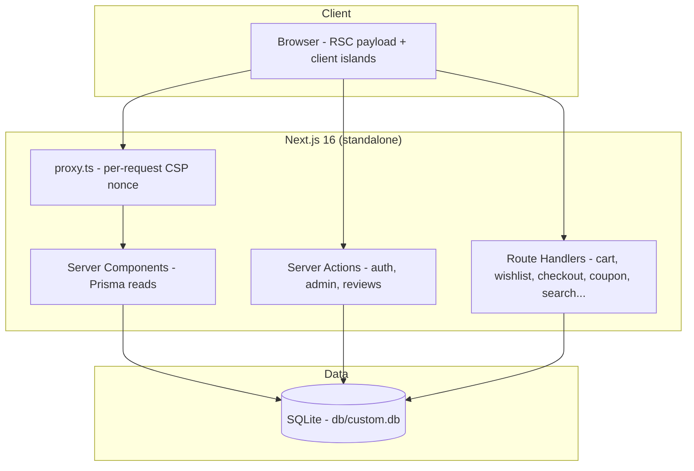

# HomeNest Kitchen

      

A production-grade e-commerce storefront + admin back office — a visual-and-functional **superset** of the Base44 reference app at [`nest-culinary-hub.base44.app`](https://nest-culinary-hub.base44.app/). Premium kitchenware catalog, guest carts, coupons, order tracking, reviews, legal pages, and a full admin console, on Next.js 16 · React 19 · TypeScript strict · Tailwind CSS v4 · Prisma 6 + SQLite.

## Quick Start

```bash
# 1. Install (Node ≥ 20; npm ≥ 10)
npm install

# 2. Create .env (or copy from the example)
cp .env.example .env      # DATABASE_URL="file:../db/custom.db" is the documented default

# 3. Create the schema + seed the catalog (idempotent)
npm run db:setup

# 4. Run
npm run dev               # http://localhost:3000
```

**Verify setup:** `curl localhost:3000/api/health` → `{"status":"ok","db":"up",...}`, and the home page renders the hero carousel with the seeded catalog.

Demo accounts (seeded):

| Role | Email | Password |
|---|---|---|
| Admin | `admin@homenestkitchen.com` | `Admin123!` |
| Customer | `demo@homenestkitchen.com` | `Demo1234!` |

## Features

| Area | Highlights |
|---|---|
| **Storefront** | Auto-rotating hero carousel · 8 category tiles · featured & new-arrival grids · search + category/sort filters + pagination · product detail with gallery, specs, reviews (read + submit) and related products · trust badges · newsletter capture |
| **Commerce** | Guest carts (token-cookie, merged on login **and at sign-in**) · mini cart drawer + cart page · coupons (`WELCOME10`, `SAVE20`, `FREESHIP`) with expiry + **atomic redemption caps** · free-shipping threshold · 3-step checkout (shipping → payment → review) with inline validation · **idempotent order placement** (retries reuse the same key — no double orders) · demo payment (clearly labeled, no real charges) · server-side total re-derivation **inside the order transaction** + atomic stock checks · transactional cart adds (no lost increments, shared 99/stock clamp) |
| **Orders** | `ORD-YYYY-NNN` order numbers · **token-gated order-success receipt** (sequential numbers alone reveal nothing) · order tracking gated by **number + purchase email** (anti-enumeration, rate-limited) with a 4-step status timeline · per-order event history · admin cancellation restores stock |
| **Accounts** | Register/login (scrypt hashes, DB-backed sessions, HMAC-signed cookie) · profile editing · address book · order history |
| **Admin** (`/admin`, role-gated) | Dashboard (KPIs + 14-day revenue chart + recent orders + low stock) · products CRUD · categories CRUD · carousel slide manager with reorder · orders manager (status workflow + carrier tracking) · analytics (top products, category mix) · store settings |
| **Content** | About, Contact (working form), 5 legal pages, 404 · SEO metadata, `sitemap.xml` (public routes only), `robots.txt` (admin/account/checkout/api disallowed) · **schema.org JSON-LD** (Product rich-result blocks with price/stock/rating/priceValidUntil, Organization + WebSite with SearchAction) · canonical URLs on every public page · **OpenGraph + Twitter share cards** (branded og-default.png, product-image share cards) · web manifest + SVG favicon · branded error boundaries |

## Architecture

| Layer | Technology | Version | Purpose |
|---|---|---|---|
| Framework | Next.js (App Router, standalone) | ^16.1 | RSC rendering, Server Actions, route handlers |
| UI runtime | React | ^19 | Server Components + client islands |
| Language | TypeScript (strict) | ^5 | `noUncheckedIndexedAccess`, no `any` |
| Styling | Tailwind CSS (CSS-first `@theme`) | ^4 | Design tokens pinned to the reference |
| Data | Prisma + SQLite | ^6.11 | 17 models; integer-cent money |
| UI primitives | Radix UI + CVA + lucide-react | latest | Accessible dialogs, selects, sheets, toasts |
| Charts | Recharts | ^3 | Admin revenue/analytics |
| Validation | Zod | ^3.25 | Every external input boundary |
| Tests | Vitest · Playwright | ^3.2 · ^1.64 | 174 unit · 39 e2e |



### DATABASE_URL contract

`.env` carries `DATABASE_URL="file:../db/custom.db"` with `db/` at the repo root (git-ignored). Relative `file:` URLs resolve against `prisma/schema.prisma` — for the CLI **and** at runtime via `src/lib/db-path.ts` — so push, seed, dev, build and the standalone server all open the same file regardless of working directory. Pinned by `tests/unit/db-path.test.ts`.

## File Hierarchy

```
📂 src/
├── 📂 app/
│   ├── 📂 (storefront)/        # public site + admin (layout = header/footer chrome)
│   │   ├── page.tsx            # home: carousel, categories, featured, new arrivals
│   │   ├── 📂 products/ 📂 product/[id]/   # listing + detail (+ gallery, reviews)
│   │   ├── 📂 cart/ 📂 checkout/ 📂 track-order/ 📂 wishlist/ 📂 account/
│   │   ├── 📂 about/ 📂 contact/ 📂 legal/[slug]/
│   │   └── 📂 admin/           # dashboard, products, orders, categories,
│   │                           # carousel, analytics, settings (role-gated)
│   ├── 📂 (auth)/              # login, register (per-request render for CSP nonces)
│   ├── 📂 api/                 # cart, wishlist, checkout, coupon/apply, cart-summary,
│   │                           # addresses, contact, newsletter, search, health
│   ├── layout.tsx              # fonts, StoreProvider + Toaster (wraps children)
│   ├── globals.css             # Tailwind v4 @theme tokens pinned to the reference
│   └── not-found.tsx / robots.ts / sitemap.ts
├── 📂 components/ (store/, ui/) # header, mobile-nav, footer, product-card, drawer...
├── 📂 lib/                      # db, db-path, auth, cart, wishlist, money, coupons,
│   │                            # order-money, settings, products, validation, csp
│   └── 📂 actions/              # server actions: auth, admin, reviews
└── proxy.ts                     # per-request CSP nonce (Next 16 proxy convention)
📂 prisma/                       # schema.prisma (17 models) + seed.ts (idempotent)
📂 tests/                        # unit/ (Vitest) · e2e/ (Playwright)
📂 db/                           # custom.db (created by db:push, git-ignored)
📂 docs/                         # SSH push skill + screenshots/
```

## Environment Variables

| Variable | Default | Purpose |
|---|---|---|
| `DATABASE_URL` | `file:../db/custom.db` | SQLite file; relative URLs resolve against `prisma/schema.prisma` |
| `NEXT_PUBLIC_SITE_URL` | `http://localhost:3000` | Canonical origin for metadata/sitemap/robots |
| `AUTH_SECRET` | dev-only fallback | **Set in production** — HMAC key for session cookies (`openssl rand -hex 32`) |

## Testing

```bash
npm run test            # 174 unit tests (Vitest, node env)
npm run typecheck:tests # the unit/e2e/seed sources are type-checked too
npm run build           # required before e2e (suite starts the standalone server)
npm run test:e2e        # 39 e2e tests (Playwright; server auto-started on :3100)
npx playwright test tests/e2e/mobile-navigation.spec.ts   # single spec
```

- **Unit** covers the money math, the `DATABASE_URL` resolution contract, coupon rules **and lifecycle gates** (incl. the atomic redemption-cap filter), scrypt hashing, Zod schemas (incl. the image-URL scheme rule), order-total derivation, the CSP builder, rate limiting **and `clientIp` derivation**, the auth-secret gate, order-access tokens, order-status transitions, the review-aggregate growth rule, the sitemap/robots privacy contract, the cart quantity clamp, the **cart-merge planner**, and the **SEO JSON-LD builders**.
- **E2E** covers the reference anatomy (home/products/detail/footer), the full guest checkout → `ORD-YYYY-NNN` → tracking loop **including the token-gated receipt and its guess-denial**, an idempotent checkout replay, the guest-cart merge at login, the admin cancel-restocks-stock flow, auth success/failure, admin gating, the **SEO/platform contracts** (`seo-platform.spec.ts`: JSON-LD on home + product pages, robots/sitemap, manifest + icon, security headers, no `X-Powered-By`), and — most importantly — `mobile-navigation.spec.ts`, the **Tailwind v4 regression guard** for the mobile menu (open/navigate/close/active-pill/scroll-lock on an iPhone-13 viewport).
- E2E specs wait for hydration (`gotoHydrated`) before interacting; clicking before hydration falls back to native form GET, which is exactly the class of bug the guard exists for.

## Design System

| Token | Value | Usage |
|---|---|---|
| `background` | `hsl(30 20% 98%)` | Warm cream page background |
| `primary` | `hsl(24 70% 50%)` | Terracotta orange — buttons, active nav pill, badges |
| `foreground` | `hsl(20 14% 12%)` | Body text |
| `badge-sale` | `hsl(0 72% 61%)` | Red "−N%" discount pill |
| `badge-featured` | `hsl(24 70% 60%)` | Orange Featured/Best Seller pill |
| `border` | `hsl(33 15% 90%)` | Card borders |

Typography: **Playfair Display** for display headings (`.font-display`), **Inter** for body — both via `next/font`. Radius: `xl` cards (12px), `3xl` heroes (24px). Tailwind v4 CSS-first config in `src/app/globals.css` (`@theme inline`; no `tailwind.config.js`).

## Screenshots

Captured from the running production build — see `docs/screenshots/`:

`01-home` … `11-checkout` · `12-admin-dashboard` … `18-admin-settings` · `19-account` · `20-mobile-home` · `21-mobile-menu-open` · `22-tracking-locked` · `23-checkout-success-locked` — regenerate with `node scripts/capture-screenshots.mjs` (server on :3000)

## Troubleshooting

| Symptom | Cause | Fix |
|---|---|---|
| `db/custom.db` appears elsewhere / stale rows survive reseed | `DATABASE_URL` shadowed by the process env | Check `node -e "console.log(process.env.DATABASE_URL)"`; converge or unset |
| Page paints but never hydrates (no console errors) | Static prerender + per-request CSP nonce mismatch | Make the route render per-request (`await connection()` — see `(auth)/layout.tsx`) |
| Mobile menu broken after a refactor | Tailwind v4 display-utility toggling | Restore the mount/transform pattern; run the mobile-navigation e2e spec |
| `EADDRINUSE :3100` during e2e | A previous standalone server is alive (process renames to `next-server`) | `pkill -f next-server` |
| npm blocks install scripts | npm's script-approval gate | `npm install-scripts approve @prisma/engines esbuild unrs-resolver` |

## License

MIT — see the repository settings. Reference app © its respective owners; this implementation shares no code with it.
